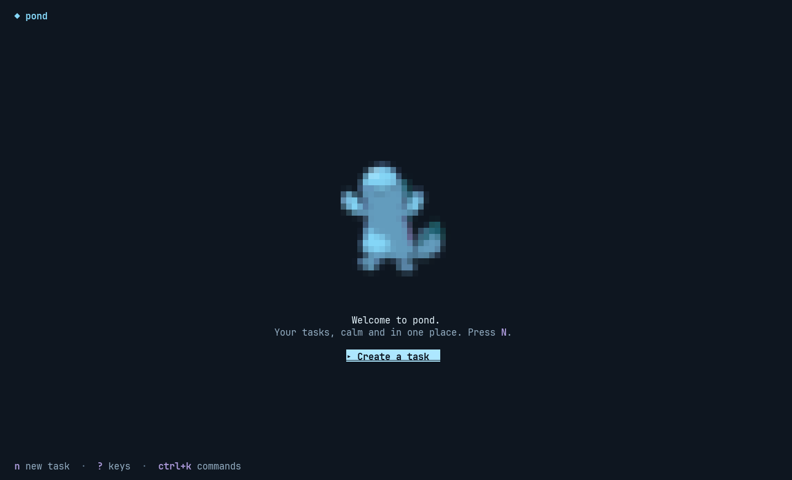

# APP-UI · Quag

The reference for every UI I build: one look, one way to build it, for terminal, desktop and Unreal.

- **[DESIGN.md](DESIGN.md)**: the look. "Quag": calm, modern, dark only, the Quagsire palette.
- **[STRUCTURE.md](STRUCTURE.md)**: the build. Atom → molecule → element → UI page; reuse library parts first,
  only atoms set colors, pages only place elements, one keymap per page.

| Folder | What |
|---|---|
| `quag-theme/` | Rust / ratatui library (`quag-theme`), its explorer (`cargo run --example explorer`) and tests |
| `quag-theme/solid/` | Solid desktop library + explorer (`npm run dev`), using `quag-theme/web/quag.css` |
| `quag-theme/unreal/QuagStyle/` | Unreal Engine editor plugin (Slate): `FQuagStyle` helpers |
| `templates/` | Starter apps: `tui-app` (Rust) and `desktop-app` (Solid) |

Checks: `cargo test --all-targets` (in `quag-theme/`), `npm test` (in `quag-theme/solid/`).
